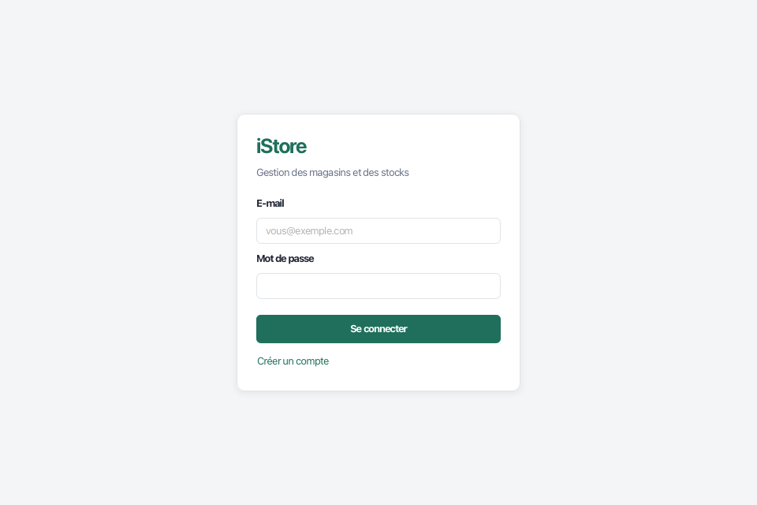
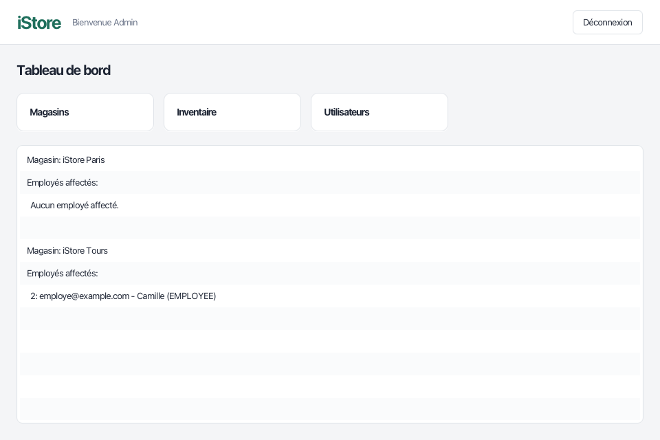
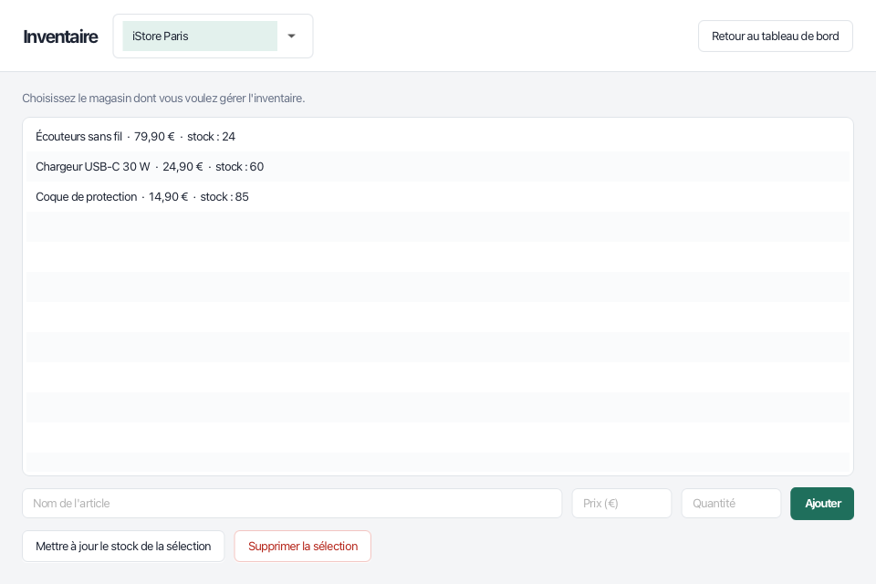
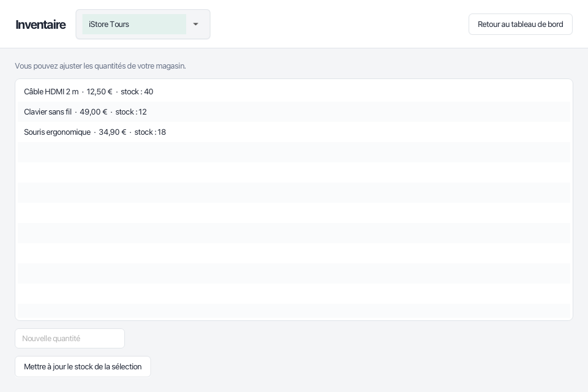
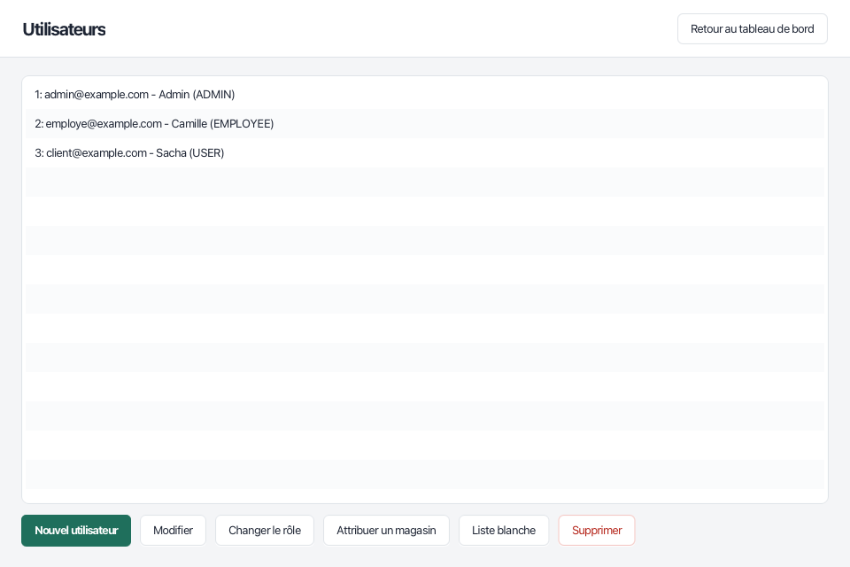

# iStore

Application de bureau de gestion de magasins et de stocks, en Java (JavaFX) avec une base MySQL.

*[English version below](#english)*



## Ce que fait l'application

- **Connexion sécurisée** : mots de passe hachés avec bcrypt.
- **Inscription contrôlée** : seuls les e-mails ajoutés à une liste blanche par un administrateur peuvent créer un compte.
- **Trois rôles**, chacun avec ses droits :

| Rôle | Magasins | Inventaire | Utilisateurs |
|---|---|---|---|
| Administrateur | Crée et supprime | Tous les magasins : ajoute, modifie, supprime des articles | Crée, modifie, change les rôles, affecte aux magasins |
| Employé | Consultation | Son magasin uniquement : ajuste les quantités | - |
| Utilisateur | Consultation | Consultation de son magasin s'il y est rattaché | - |

| Tableau de bord | Inventaire (administrateur) |
|---|---|
|  |  |
| **Inventaire (employé)** | **Utilisateurs** |
|  |  |

## Lancer le projet

Prérequis : Java 21 ou plus récent, et Docker. Maven n'est pas nécessaire, le projet embarque `mvnw`.

```sh
git clone https://github.com/daviddahoui/Istorejv.git
cd Istorejv
docker compose up -d      # base MySQL avec des données de démonstration
./mvnw javafx:run         # lance l'application
```

Sous Windows, remplacez `./mvnw` par `mvnw.cmd`.

### Comptes de démonstration

| E-mail | Mot de passe | Rôle |
|---|---|---|
| admin@example.com | admin123 | Administrateur |
| employe@example.com | employe123 | Employée du magasin de Tours |
| client@example.com | client123 | Utilisateur |

L'adresse `nouveau@example.com` est sur la liste blanche : elle permet d'essayer l'inscription.

### Configuration

Par défaut, l'application se connecte à la base du `docker-compose.yml`. Pour une autre base, définissez :

| Variable | Valeur par défaut |
|---|---|
| `ISTORE_DB_URL` | `jdbc:mysql://localhost:3306/istoredb?...` |
| `ISTORE_DB_USER` | `istore` |
| `ISTORE_DB_PASSWORD` | `istore` |

La structure de la base est dans [`database/01-schema.sql`](database/01-schema.sql).

## Tests

```sh
docker compose up -d
./mvnw verify
```

Les tests d'accès aux données tournent sur la vraie base MySQL. Ils sont aussi exécutés automatiquement par GitHub Actions à chaque modification.

## Organisation du code

```
src/main/java/com/istorejv/
├── model/        Article, Inventory, Store, User, Role
├── dao/          requêtes SQL (JDBC, requêtes préparées)
├── service/      règles métier (droits, validations)
├── controller/   logique des écrans JavaFX
└── util/         connexion, session, navigation, hachage
src/main/resources/
├── view/         écrans (FXML)
└── css/          thème
database/         structure et données de démonstration
```

## Historique

Projet réalisé en février 2025 pendant mes études d'informatique à SUPINFO Tours. Remis à jour en octobre 2026 :
- passage à Java 21 et JavaFX 21 ;
- base de données livrée avec le projet, lancée par Docker ;
- correction des droits (l'écran Magasins ne vérifiait pas le rôle, l'inventaire affichait toujours le premier magasin) ;
- saisie des mots de passe masquée dans les fenêtres d'administration ;
- nouvelle interface et intégration continue.

## Licence

Apache 2.0, voir [LICENSE](LICENSE).

---

<a id="english"></a>

## English

iStore is a desktop app to manage stores and their stock, written in Java (JavaFX) with a MySQL database.

**Features**: bcrypt-hashed passwords, sign-up restricted to a whitelist of e-mails, and three roles:
- **Admin**: manages stores, every inventory and every user.
- **Employee**: adjusts stock in the store they are assigned to.
- **User**: read-only access.

**Run it** (Java 21+ and Docker required):

```sh
docker compose up -d
./mvnw javafx:run
```

Demo accounts: `admin@example.com` / `admin123`, `employe@example.com` / `employe123`, `client@example.com` / `client123`.

**Tests**: `./mvnw verify` with the database running. They also run on every push through GitHub Actions.

Built in February 2025 as a student project at SUPINFO Tours, updated in October 2026. Licensed under Apache 2.0.
